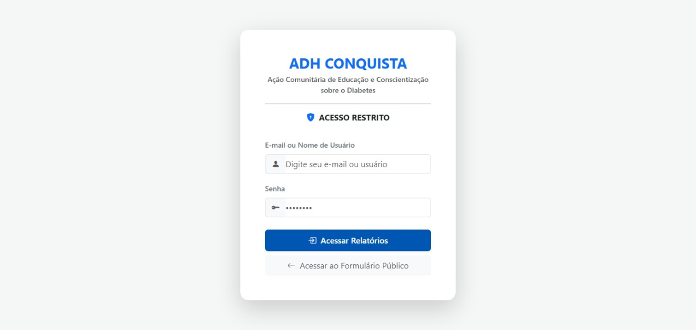
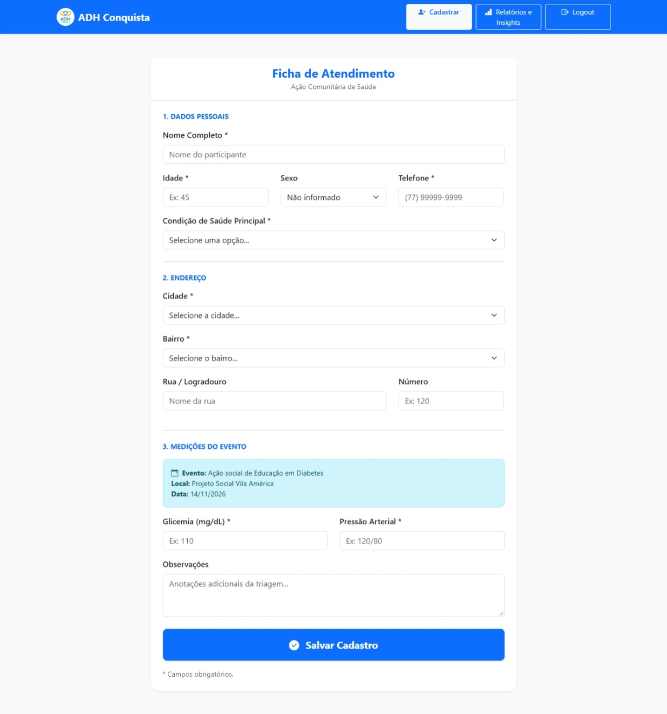
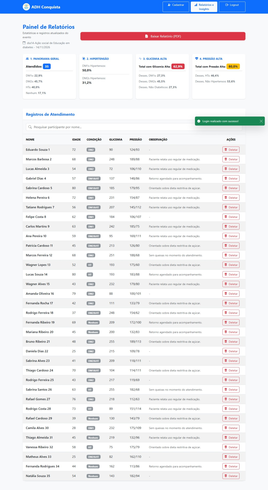

# 🩺 Triagem ADH


## Descrição do projeto

O **Triagem ADH** é um sistema desenvolvido para auxiliar no cadastro e na triagem dos participantes da *Ação Comunitária de Educação e Conscientização do Diabetes*, promovida pela Associação de Diabéticos e Hipertensos de Vitória da Conquista. A aplicação permite o registro de medições de glicemia e pressão arterial, observações clínicas, além da geração de estatísticas e relatórios em PDF a partir dos dados coletados.

## Contexto da Ação

Durante a ação comunitária, os dados coletados também foram utilizados para identificar participantes que necessitavam de acompanhamento pela associação, considerando condições de saúde previamente informadas e medições de glicemia e pressão arterial que demandassem atenção.

A ADH desenvolve um trabalho social voltado à promoção da saúde, à educação em diabetes e ao apoio a pessoas que enfrentam dificuldades no acesso a um atendimento de saúde adequado.

## 🌐 Status e Ambientes Disponíveis

O sistema possui dois ambientes independentes, permitindo a utilização oficial pela associação e a exploração pública de suas funcionalidades.

| Ambiente | Hospedagem | Banco de Dados | Finalidade |
| :--- | :--- | :--- | :--- |
| **Produção** | Vercel | PostgreSQL (Neon) | Uso oficial pela equipe da ADH Conquista, com armazenamento dos dados operacionais. |
| **Demonstração** | Render | SQLite | Ambiente público destinado à exploração e avaliação das funcionalidades, sem interferência na base oficial. |

🔗 **[Acessar versão demonstrativa](INSIRA_A_URL_DA_DEMO)**

> **Observação:** Os dados disponibilizados na versão demonstrativa são fictícios e foram gerados com auxílio de inteligência artificial, não correspondendo a registros reais de participantes.

> **Limitações da demonstração:** A instância demonstrativa destina-se exclusivamente à exploração das funcionalidades do sistema. Por se tratar de um ambiente de demonstração hospedado em infraestrutura que pode apresentar limitações de disponibilidade e persistência, os dados registrados durante os testes não devem ser considerados permanentes. A demonstração não deve ser utilizada para armazenar informações pessoais ou dados reais de saúde.

## 🚀 Perspectivas de evolução

O sistema encontra-se em produção, mas seu desenvolvimento prevê futuras expansões para atender às novas necessidades da ADH. A evolução do software dependerá de um levantamento e refinamento dos requisitos, visando ampliar as funcionalidades e apoiar outras atividades da associação.

Entre as possíveis áreas de expansão, destacam-se:

- **Gerenciamento de associados:** organização de informações de contato, condições de saúde e tratamentos dos associados.
- **Gerenciamento de insumos:** controle dos insumos recebidos por meio de doações e de sua distribuição aos associados que necessitam.
- **Gerenciamento de eventos:** organização das informações referentes aos eventos promovidos pela associação, incluindo participantes e triagens realizadas.
- **Gerenciamento de triagens:** acompanhamento das triagens realizadas pelos associados, permitindo o registro e a consulta de medições e a observação da evolução de seus indicadores de saúde.

## ⚙️ Funcionalidades e demonstração da aplicação

- **Cadastro de participantes:** registro dos participantes e de suas informações de saúde coletadas durante a ação.
- **Geração de estatísticas:** consolidação e apresentação dos dados registrados, auxiliando na análise das informações coletadas.
- **Exportação de relatórios em PDF:** geração de documentos contendo os registros e as estatísticas da triagem.

## 🔐 Segurança e privacidade

Por lidar com informações relacionadas à saúde, o sistema considera a proteção e a privacidade dos dados como aspectos importantes de seu desenvolvimento e utilização.

- **Separação de ambientes:** a versão demonstrativa é independente do ambiente de produção, evitando interferência nos dados operacionais da associação.
- **Controle de acesso:** o acesso às funcionalidades administrativas e aos registros é restrito por autenticação.
- **Dados demonstrativos:** a versão pública utiliza dados fictícios, não sendo destinada ao armazenamento de informações reais de participantes.
- **Privacidade dos dados:** informações relacionadas à saúde exigem cuidados específicos quanto ao acesso, armazenamento e utilização, considerando os princípios de privacidade e proteção de dados.

## 📸 Screenshots

*As capturas de tela a seguir foram realizadas a partir da versão demonstrativa do sistema.*

### Tela de login



### Tela de cadastro



### Tela de relatórios



## 💻 Setup

### 1. Clonar o repositório

```bash
git clone https://github.com/Nuillexe/adh-triagem.git
cd adh-triagem
```

### 2. Configurar as variáveis de ambiente

Copie o arquivo de exemplo de variáveis de ambiente e configure os valores necessários para a execução local.

```bash
cp .env.example .env
```

### 3. Acessar o diretório da aplicação

```bash
cd dia14
```

### 4. Instalar as dependências

```bash
pip install -r requirements.txt
```

### 5. Aplicar as migrações

```bash
python manage.py migrate
```

### 6. Executar o servidor local

```bash
python manage.py runserver
```

Após iniciar o servidor, a aplicação estará disponível localmente em:

http://127.0.0.1:8000/

## Considerações finais

O Triagem ADH representa uma iniciativa de aplicação da tecnologia em apoio às atividades sociais e de saúde desenvolvidas pela Associação de Diabéticos e Hipertensos de Vitória da Conquista. Além de auxiliar na organização dos dados coletados durante a ação comunitária, o projeto estabelece uma base para futuras melhorias e digitalização de outros processos da associação, acompanhando suas necessidades e possibilidades de expansão.
